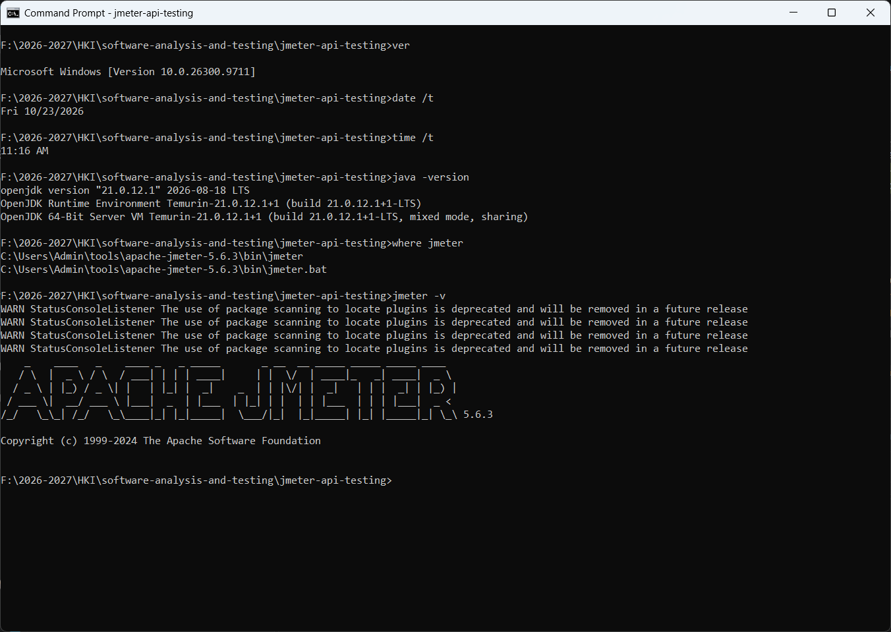
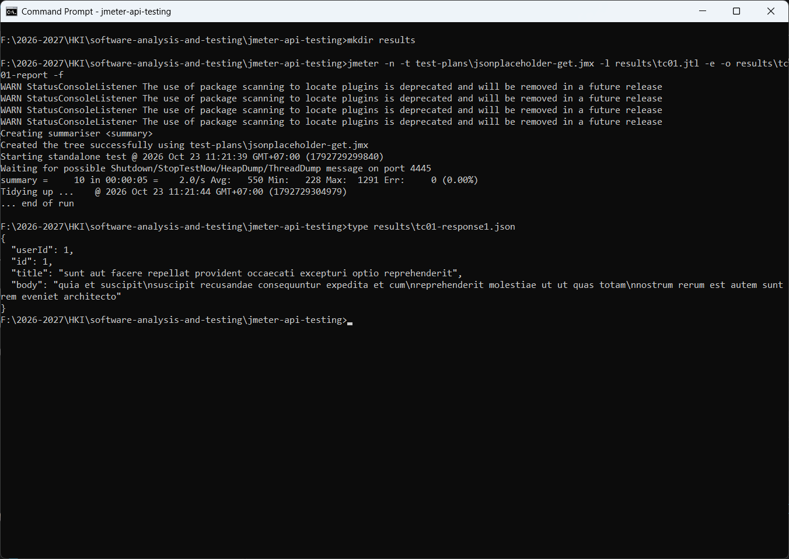
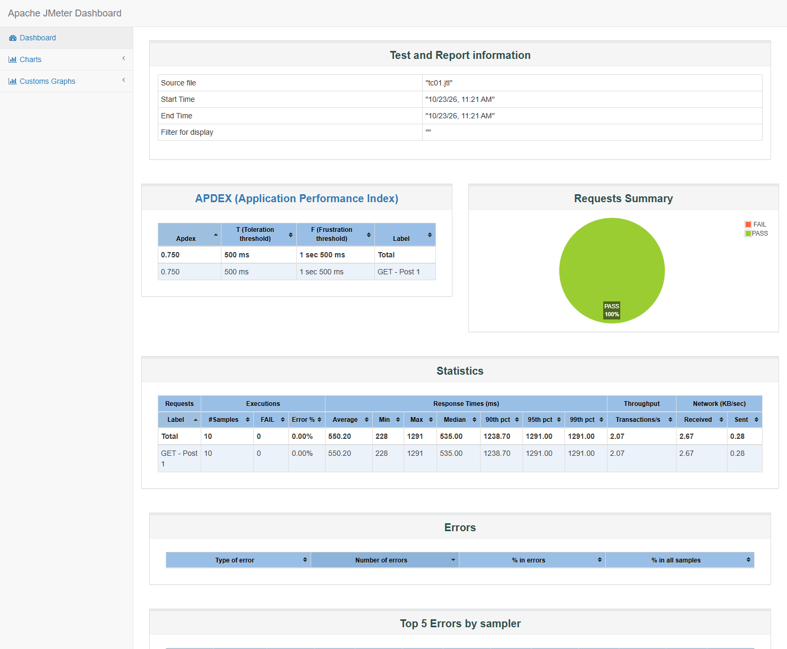
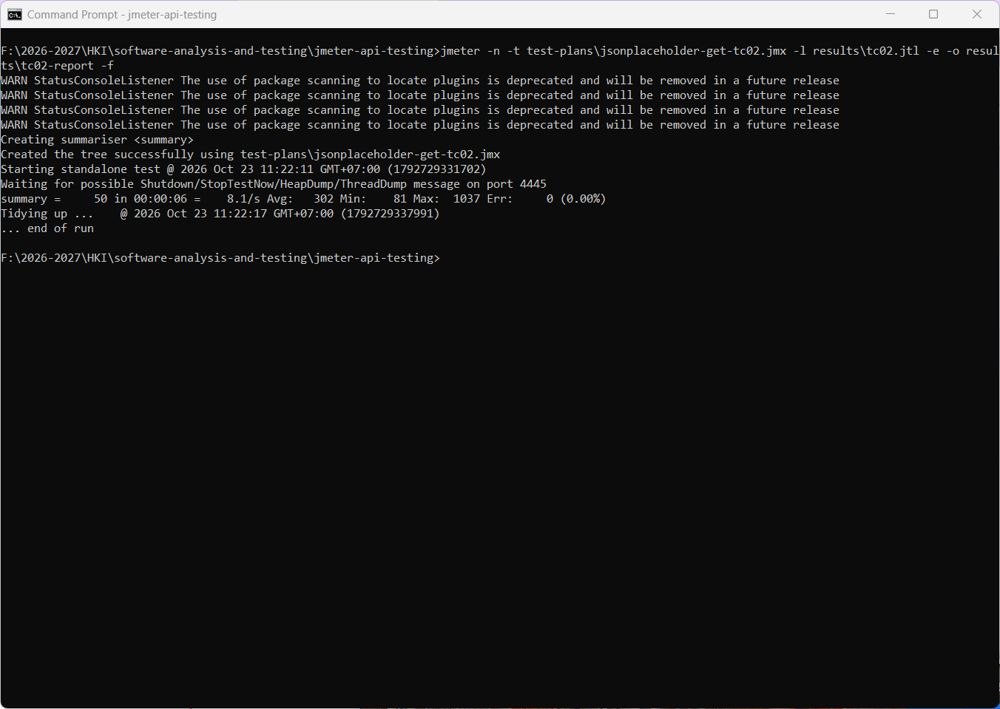
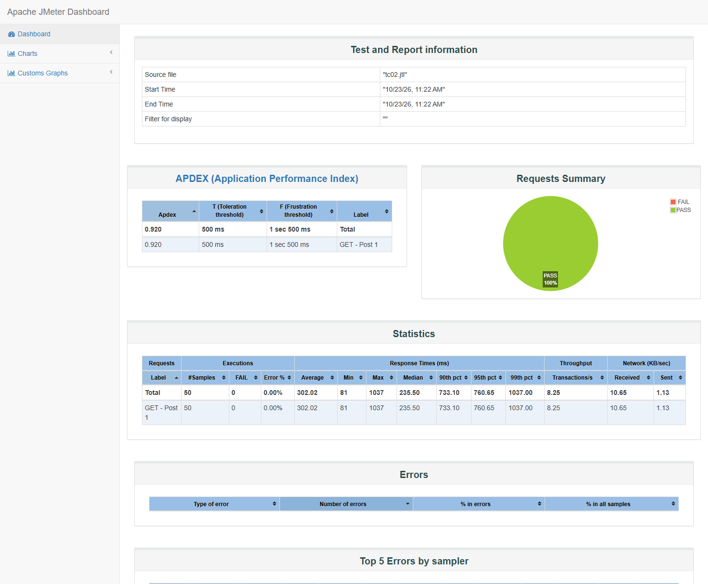
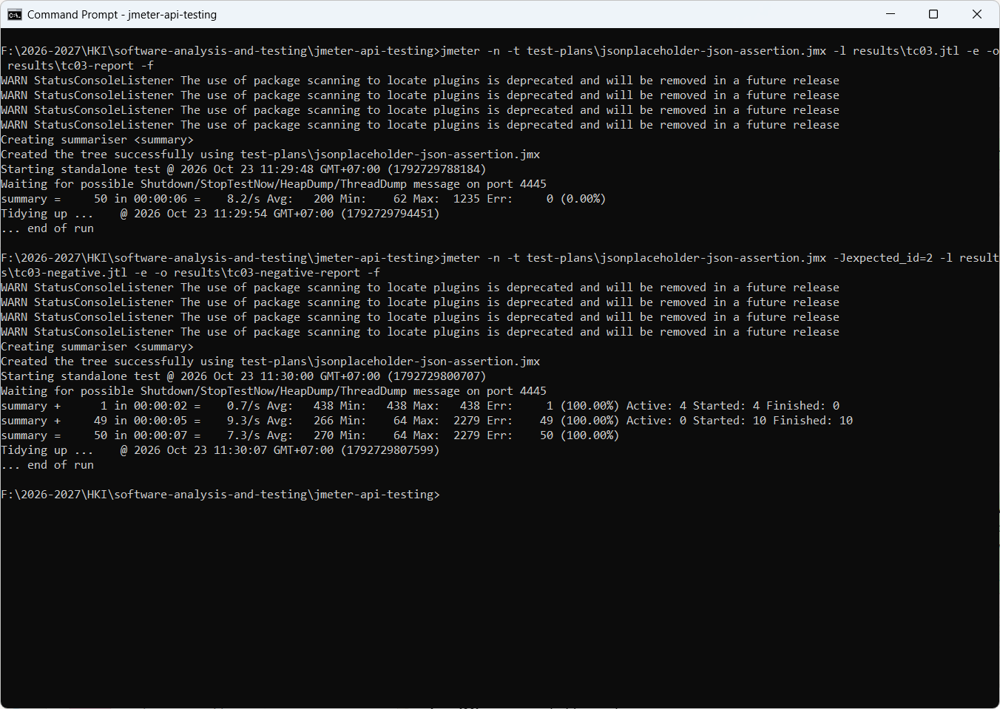
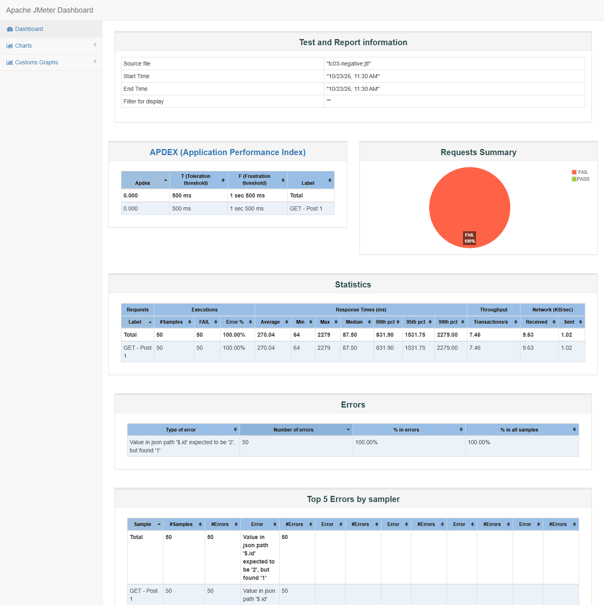

# Apache JMeter - API Testing with JSONPlaceholder

## 1. Giới thiệu

### 1.1. Tổng quan

Bài thực hành được thực hiện nhằm tìm hiểu và áp dụng **Apache JMeter** trong kiểm thử API. Thông qua bài thực hành, người thực hiện xây dựng các kịch bản kiểm thử HTTP, gửi yêu cầu đến API, theo dõi phản hồi từ máy chủ và đánh giá các chỉ số cơ bản về hiệu năng.

API được sử dụng là **JSONPlaceholder**, một REST API công khai phục vụ mục đích thực hành và thử nghiệm. Endpoint được lựa chọn trả về thông tin của một bài viết cụ thể.

Toàn bộ số liệu và hình ảnh trong tài liệu này được ghi nhận từ lần chạy thực tế trên máy tính Windows cá nhân, bằng **Command Prompt** ở chế độ dòng lệnh (non-GUI) của JMeter, ngày **23/10/2026**.

### 1.2. Mục tiêu

Bài thực hành hướng đến các mục tiêu sau:

- Làm quen với Apache JMeter và cách chạy Test Plan ở chế độ dòng lệnh.
- Xây dựng Test Plan để kiểm thử API bằng giao thức HTTP.
- Cấu hình Thread Group, HTTP Request, Assertion và các thành phần theo dõi kết quả.
- Thực hiện kiểm thử với các mức tải khác nhau.
- Đọc và phân tích các chỉ số như số lượng mẫu, thời gian phản hồi trung bình, nhỏ nhất, lớn nhất, phân vị, độ lệch chuẩn, tỷ lệ lỗi và thông lượng.
- Kiểm tra tính chính xác của dữ liệu JSON trả về bằng JSON Assertion, và chứng minh assertion thực sự phát hiện được dữ liệu sai.
- Xuất báo cáo HTML Dashboard và lưu kịch bản, ảnh minh chứng, báo cáo trên GitHub.

## 2. Công cụ và môi trường thực hiện

| Thành phần | Thông tin |
|---|---|
| Máy tính | Lenovo 82XV, Intel Core i7-13620H |
| Hệ điều hành | Microsoft Windows 11 Pro (Version 10.0.26300) |
| Dòng lệnh | Command Prompt (cmd.exe) |
| Công cụ kiểm thử | Apache JMeter 5.6.3 (`C:\Users\Admin\tools\apache-jmeter-5.6.3`) |
| Phiên bản Java | OpenJDK 21.0.12.1 (Eclipse Temurin) |
| Đối tượng kiểm thử | JSONPlaceholder REST API |
| Phương thức HTTP | GET |
| Định dạng dữ liệu phản hồi | JSON |
| Công cụ quản lý mã nguồn | Git |
| Nền tảng lưu trữ | GitHub |
| Ngày chạy | 23/10/2026 |



Ảnh Command Prompt hiển thị phiên bản Windows, ngày giờ chạy, phiên bản Java, vị trí cài đặt và phiên bản JMeter trên máy thực hiện. Bốn dòng `WARN StatusConsoleListener ...` là cảnh báo của thư viện log4j đi kèm JMeter 5.6.3, không ảnh hưởng đến kết quả kiểm thử.

## 3. Đối tượng kiểm thử

### 3.1. Thông tin API

API được sử dụng trong bài thực hành:

- **Base URL:** `https://jsonplaceholder.typicode.com`
- **Endpoint:** `/posts/1`
- **HTTP Method:** `GET`
- **URL đầy đủ:** `https://jsonplaceholder.typicode.com/posts/1`

Yêu cầu GET được sử dụng để lấy thông tin bài viết có mã định danh là `1`.

### 3.2. Cấu trúc phản hồi

Khi yêu cầu hợp lệ được xử lý thành công, API trả về dữ liệu ở định dạng JSON với các trường cơ bản:

| Trường | Ý nghĩa |
|---|---|
| `userId` | Mã định danh người dùng sở hữu bài viết |
| `id` | Mã định danh bài viết |
| `title` | Tiêu đề bài viết |
| `body` | Nội dung bài viết |

Phản hồi thực tế mà JMeter nhận được và lưu lại trong lần chạy TC01 (`results\tc01-response1.json`):

```json
{
  "userId": 1,
  "id": 1,
  "title": "sunt aut facere repellat provident occaecati excepturi optio reprehenderit",
  "body": "quia et suscipit\nsuscipit recusandae consequuntur expedita et cum\nreprehenderit molestiae ut ut quas totam\nnostrum rerum est autem sunt rem eveniet architecto"
}
```

### 3.3. Tiêu chí kiểm thử

Bài thực hành sử dụng các tiêu chí sau:

- API trả về mã trạng thái HTTP `200 OK` đối với yêu cầu GET thành công (kiểm tra bằng Response Assertion trong TC03).
- Nội dung phản hồi có định dạng JSON hợp lệ.
- Trường `id` trong phản hồi có giá trị **đúng bằng** `1`.
- Số mẫu được gửi đi khớp với cấu hình Thread Group.
- Theo dõi tỷ lệ lỗi và các chỉ số thời gian phản hồi để đánh giá kết quả của từng kịch bản.

## 4. Cấu trúc repository

```text
jmeter-api-testing/
├── .gitignore
├── README.md
├── test-plans/
│   ├── jsonplaceholder-get.jmx
│   ├── jsonplaceholder-get-tc02.jmx
│   └── jsonplaceholder-json-assertion.jmx
└── screenshots/
    ├── environment-command-prompt.png
    ├── tc01-command-prompt.png
    ├── tc01-dashboard.png
    ├── tc02-command-prompt.png
    ├── tc02-dashboard.png
    ├── tc03-command-prompt.png
    ├── tc03-dashboard.png
    └── tc03-negative-dashboard.png
```

Ý nghĩa các thành phần:

- `README.md`: tài liệu giới thiệu, mô tả kịch bản và tổng hợp kết quả kiểm thử.
- `test-plans/`: chứa các file `.jmx` lưu cấu hình Test Plan của JMeter.
- `screenshots/`: ảnh chụp cửa sổ Command Prompt và báo cáo HTML Dashboard của lần chạy thực tế.
- `results/`: được tạo khi chạy kiểm thử, chứa file kết quả `.jtl`, báo cáo HTML Dashboard và phản hồi đã lưu. Thư mục này nằm trong `.gitignore` vì có thể tạo lại bất cứ lúc nào.

## 5. Thiết kế kịch bản kiểm thử

Bài thực hành gồm ba Test Plan tương ứng với ba mục tiêu: kiểm thử GET cơ bản, kiểm thử với mức tải lớn hơn và kiểm tra nội dung JSON.

Cả ba HTTP Request đều đặt **Connect Timeout = 5000 ms** và **Response Timeout = 10000 ms**, để một kết nối bị treo được ghi nhận là lỗi thay vì làm treo cả lần chạy (xem mục 6).

### 5.1. TC01 - Kiểm thử GET API cơ bản

**File:** [`test-plans/jsonplaceholder-get.jmx`](test-plans/jsonplaceholder-get.jmx)

#### Mục tiêu

Kiểm tra khả năng gửi yêu cầu GET đến endpoint `/posts/1`, quan sát phản hồi của API và thu thập các chỉ số hiệu năng cơ bản.

#### Cấu hình

| Tham số | Giá trị |
|---|---|
| Number of Threads (Users) | 5 |
| Ramp-Up Period | 5 giây |
| Loop Count | 2 |
| Tổng số mẫu dự kiến | 10 |
| HTTP Method | GET |
| Path | `/posts/1` |

Với 5 người dùng ảo, mỗi người thực hiện 2 lần lặp, tổng số yêu cầu dự kiến là:

`5 × 2 = 10 requests`

#### Các thành phần JMeter

- **Test Plan:** `TC01 - Basic GET API Test`, chứa toàn bộ cấu hình kiểm thử.
- **Thread Group:** xác định số người dùng ảo, thời gian khởi chạy và số lần lặp.
- **HTTP Request:** gửi yêu cầu GET đến API.
- **View Results Tree / Summary Report:** xem kết quả khi mở Test Plan bằng giao diện JMeter.
- **Save Responses to a file:** lưu nội dung phản hồi của từng mẫu thành `results/tc01-response<N>.json`.

#### Lệnh chạy

```bat
jmeter -n -t test-plans\jsonplaceholder-get.jmx -l results\tc01.jtl -e -o results\tc01-report -f
type results\tc01-response1.json
```

#### Kết quả

| Chỉ số | Kết quả |
|---|---:|
| Samples | 10 |
| Average | 550.20 ms |
| Min | 228 ms |
| Max | 1291 ms |
| Median | 535.00 ms |
| 90th / 95th / 99th pct | 1238.70 / 1291.00 / 1291.00 ms |
| Std. Dev. | 333.49 ms |
| Error % | 0.00% |
| Throughput | 2.07 requests/second |
| Received KB/sec | 2.67 |
| Sent KB/sec | 0.28 |
| Avg. Bytes | 1321.4 |
| Mã phản hồi | 200 (cả 10 mẫu) |

#### Nhận xét

- JMeter ghi nhận đúng 10 mẫu theo cấu hình đã thiết lập.
- Tỷ lệ lỗi là `0.00%`, cả 10 mẫu đều trả về `200 OK`.
- Thời gian phản hồi trung bình là `550.20 ms`, dao động từ `228 ms` đến `1291 ms`.
- Độ lệch chuẩn `333.49 ms` khá lớn so với trung bình: với chỉ 10 mẫu, các yêu cầu đầu tiên của mỗi luồng phải thiết lập kết nối TLS mới nên chậm hơn đáng kể và kéo trung bình lên.
- Nội dung phản hồi được lưu lại và in ra bằng lệnh `type`, khớp với cấu trúc mô tả ở mục 3.2.

Các kết quả trên phản ánh lần chạy cụ thể, không đại diện cho hiệu năng cố định của API trong mọi điều kiện mạng hoặc tải hệ thống.

#### Ảnh minh chứng

**Command Prompt - TC01** (kết quả chạy và nội dung JSON phản hồi)



**HTML Dashboard - TC01**



### 5.2. TC02 - Kiểm thử với số lượng yêu cầu lớn hơn

**File:** [`test-plans/jsonplaceholder-get-tc02.jmx`](test-plans/jsonplaceholder-get-tc02.jmx)

#### Mục tiêu

Thay đổi cấu hình người dùng ảo và số lần lặp nhằm quan sát các chỉ số của API khi số lượng yêu cầu tăng lên so với TC01.

#### Cấu hình

| Tham số | Giá trị |
|---|---|
| Number of Threads (Users) | 10 |
| Ramp-Up Period | 5 giây |
| Loop Count | 5 |
| Tổng số mẫu dự kiến | 50 |
| HTTP Method | GET |
| Path | `/posts/1` |
| Assertion | JSON Assertion `$.id` = `1` |

Tổng số yêu cầu dự kiến:

`10 × 5 = 50 requests`

So với TC01, TC02 tăng số người dùng ảo từ 5 lên 10 và tăng số lần lặp từ 2 lên 5. Vì vậy, tổng số mẫu dự kiến tăng từ 10 lên 50.

#### Lệnh chạy

```bat
jmeter -n -t test-plans\jsonplaceholder-get-tc02.jmx -l results\tc02.jtl -e -o results\tc02-report -f
```

#### Kết quả

| Chỉ số | Kết quả |
|---|---:|
| Samples | 50 |
| Average | 302.02 ms |
| Min | 81 ms |
| Max | 1037 ms |
| Median | 235.50 ms |
| 90th / 95th / 99th pct | 733.10 / 760.65 / 1037.00 ms |
| Std. Dev. | 214.04 ms |
| Error % | 0.00% |
| Throughput | 8.25 requests/second |
| Received KB/sec | 10.65 |
| Sent KB/sec | 1.13 |
| Avg. Bytes | 1321.9 |
| Mã phản hồi | 200 (cả 50 mẫu) |

#### Nhận xét

- JMeter ghi nhận 50 mẫu, phù hợp với số lượng yêu cầu dự kiến theo cấu hình.
- Tỷ lệ lỗi là `0.00%`, đồng thời JSON Assertion trên `$.id` đều đạt.
- Thời gian phản hồi trung bình là `302.02 ms`, trung vị `235.50 ms`, dao động từ `81 ms` đến `1037 ms`.
- Thông lượng ghi nhận là `8.25 requests/second`.

TC02 có thời gian trung bình thấp hơn và thông lượng cao hơn TC01. Tuy nhiên, không thể kết luận rằng tăng tải làm API phản hồi nhanh hơn chỉ từ hai lần chạy này: với nhiều mẫu hơn, chi phí thiết lập kết nối của các yêu cầu đầu tiên được chia đều cho nhiều yêu cầu tái sử dụng kết nối (keep-alive), nên trung bình giảm. Kết quả còn chịu ảnh hưởng của thời điểm thực hiện, độ trễ mạng và trạng thái máy chủ.

#### Ảnh minh chứng

**Command Prompt - TC02**



**HTML Dashboard - TC02**



### 5.3. TC03 - Kiểm tra nội dung JSON bằng JSON Assertion

**File:** [`test-plans/jsonplaceholder-json-assertion.jmx`](test-plans/jsonplaceholder-json-assertion.jmx)

#### Mục tiêu

Kiểm tra không chỉ việc API phản hồi thành công mà còn xác nhận dữ liệu trả về có giá trị đúng theo yêu cầu, đồng thời chứng minh assertion phát hiện được trường hợp dữ liệu không khớp.

#### Cấu hình

| Tham số | Giá trị |
|---|---|
| Number of Threads (Users) | 10 |
| Ramp-Up Period | 5 giây |
| Loop Count | 5 |
| Tổng số mẫu dự kiến | 50 |
| Response Assertion | Response Code **Equals** `200` |
| JSON Assertion - JSON Path | `$.id` |
| JSON Assertion - Expected Value | `${__P(expected_id,1)}` (mặc định `1`) |
| JSON Assertion - Match as regular expression | Tắt (so sánh chính xác) |

JSON Path `$.id` có nghĩa là truy cập trường `id` ở cấp cao nhất của đối tượng JSON.

Giá trị mong đợi được đọc từ thuộc tính `expected_id` thông qua hàm `${__P(expected_id,1)}`. Khi chạy bình thường, giá trị mặc định là `1`. Khi truyền `-Jexpected_id=2` từ dòng lệnh, assertion được kỳ vọng sẽ **thất bại** với mọi mẫu. Đây là kiểm thử âm tính để chứng minh assertion thực sự kiểm tra dữ liệu.

#### Lệnh chạy

```bat
jmeter -n -t test-plans\jsonplaceholder-json-assertion.jmx -l results\tc03.jtl -e -o results\tc03-report -f
jmeter -n -t test-plans\jsonplaceholder-json-assertion.jmx -Jexpected_id=2 -l results\tc03-negative.jtl -e -o results\tc03-negative-report -f
```

#### Kết quả

| Chỉ số | TC03 (`expected_id = 1`) | TC03 âm tính (`expected_id = 2`) |
|---|---:|---:|
| Samples | 50 | 50 |
| Số mẫu lỗi | 0 | 50 |
| Error % | 0.00% | 100.00% |
| Average | 200.18 ms | 270.04 ms |
| Min | 62 ms | 64 ms |
| Max | 1235 ms | 2279 ms |
| Median | 82.00 ms | 87.50 ms |
| Std. Dev. | 224.13 ms | 449.39 ms |
| Throughput | 8.36 requests/second | 7.46 requests/second |
| Mã phản hồi | 200 (cả 50 mẫu) | 200 (cả 50 mẫu) |

Thông báo lỗi của lần chạy âm tính, được ghi nhận trong bảng Errors của HTML Dashboard:

```text
Value in json path '$.id' expected to be '2', but found '1'
```

#### Ý nghĩa

- Với giá trị mong đợi `1`, toàn bộ 50 mẫu đạt cả Response Assertion (`200`) và JSON Assertion (`$.id = 1`).
- Với giá trị mong đợi `2`, toàn bộ 50 mẫu bị đánh dấu lỗi, mặc dù máy chủ vẫn trả về `200 OK`. Điều này cho thấy JSON Assertion phát hiện được trường hợp API phản hồi HTTP thành công nhưng nội dung dữ liệu không đúng yêu cầu.

Vì vậy, kiểm thử kết hợp mã trạng thái HTTP với assertion trên nội dung JSON cung cấp mức xác minh tốt hơn so với chỉ kiểm tra mã trạng thái.

#### Ảnh minh chứng

**Command Prompt - TC03 và TC03 âm tính**



**HTML Dashboard - TC03**


**HTML Dashboard - TC03 âm tính** (`-Jexpected_id=2`)



## 6. Lỗi phát hiện khi chạy và cách khắc phục

Trong quá trình cài đặt và chạy lại các Test Plan trên máy Windows, các vấn đề sau đã được phát hiện và khắc phục:

| # | Vấn đề | Bằng chứng | Cách khắc phục |
|---|---|---|---|
| 1 | `jsonplaceholder-get.jmx` (TC01) được cấu hình **10 threads × 5 loops**, không khớp với thiết kế 5 × 2 = 10 mẫu, và giống hệt TC02 | Chạy file gốc: `summary = 50 in 00:00:06` | Sửa Thread Group thành 5 threads, 2 loops. Chạy lại: `summary = 10` |
| 2 | JSON Assertion trong TC02 và TC03 bật **Match as regular expression** với giá trị `1` | Biểu thức chính quy `1` cũng khớp với `10`, `11`, `21`, ... nên assertion có thể đạt dù `id` sai | Tắt regex (`ISREGEX = false`) để so sánh chính xác |
| 3 | Tiêu chí yêu cầu mã `200 OK` nhưng không có assertion kiểm tra mã trạng thái | JMeter mặc định coi mọi mã 2xx/3xx là thành công | Thêm Response Assertion `Response Code Equals 200` vào TC03 |
| 4 | HTTP Request không đặt timeout | Trong một lần chạy thử, một yêu cầu bị treo ở bước kết nối **660975 ms (khoảng 11 phút)** làm cả lần chạy kéo dài theo | Đặt Connect Timeout 5000 ms, Response Timeout 10000 ms cho cả ba Test Plan |
| 5 | Lệnh `-e -o results\tc01-report` báo lỗi `Cannot write to '...\results\tc01-report' as folder does not exist and parent folder is not writable` | Lần chạy đầu tiên trên máy mới, khi chưa có thư mục `results` | Tạo thư mục bằng `mkdir results` trước khi chạy (đã đưa vào hướng dẫn ở mục 7) |
| 6 | Ba Test Plan cùng tên `JSONPlaceholder API Test` | Khó phân biệt khi mở trong giao diện JMeter | Đổi tên thành `TC01 - Basic GET API Test`, `TC02 - Higher Load GET API Test`, `TC03 - JSON Assertion Test` |

Ngoài ra, TC03 được tham số hóa giá trị mong đợi (`${__P(expected_id,1)}`) để có thể chạy kiểm thử âm tính mà không cần sửa file `.jmx`.

## 7. Tổng hợp kết quả kiểm thử

### 7.1. Bảng so sánh các kịch bản

| Chỉ số | TC01 | TC02 | TC03 |
|---|---:|---:|---:|
| Number of Threads | 5 | 10 | 10 |
| Ramp-Up Period | 5 giây | 5 giây | 5 giây |
| Loop Count | 2 | 5 | 5 |
| Samples | 10 | 50 | 50 |
| Average | 550.20 ms | 302.02 ms | 200.18 ms |
| Min | 228 ms | 81 ms | 62 ms |
| Max | 1291 ms | 1037 ms | 1235 ms |
| Median | 535.00 ms | 235.50 ms | 82.00 ms |
| 90th pct | 1238.70 ms | 733.10 ms | 573.30 ms |
| Std. Dev. | 333.49 ms | 214.04 ms | 224.13 ms |
| Error % | 0.00% | 0.00% | 0.00% |
| Throughput | 2.07 requests/sec | 8.25 requests/sec | 8.36 requests/sec |

### 7.2. Đánh giá chung

- **Về số lượng mẫu:** cả ba kịch bản đều ghi nhận đúng số mẫu dự kiến theo cấu hình.
- **Về tỷ lệ lỗi:** cả ba kịch bản đều ghi nhận `0.00%`; mọi mẫu trả về `200 OK`.
- **Về thời gian phản hồi:** trung vị của TC02 và TC03 (`235.50 ms`, `82.00 ms`) thấp hơn nhiều so với trung bình, cho thấy phần lớn yêu cầu nhanh và một số ít yêu cầu đầu tiên (thiết lập kết nối) chậm hơn.
- **Về độ chính xác dữ liệu:** JSON Assertion xác nhận `$.id = 1` ở 100% mẫu, và phát hiện 100% mẫu sai khi đổi giá trị mong đợi thành `2`.

Dữ liệu hiện tại chỉ phản ánh một số lần chạy thử nghiệm với một endpoint, chưa đủ để đưa ra kết luận tổng quát về giới hạn chịu tải hoặc hiệu năng tối đa của hệ thống.

### 7.3. Phân biệt kiểm thử chức năng và kiểm thử hiệu năng

- **Kiểm thử chức năng:** xác minh API trả về mã `200` và trường JSON `id` có giá trị bằng `1` (TC03, cùng kiểm thử âm tính).
- **Kiểm thử hiệu năng cơ bản:** ghi nhận thời gian phản hồi, thông lượng, số lượng mẫu và tỷ lệ lỗi trong các cấu hình tải khác nhau (TC01, TC02).

## 8. Hướng dẫn chạy lại trên Windows (Command Prompt)

### 8.1. Cài đặt JMeter

1. Cài Java 8 trở lên (máy thực hiện dùng Eclipse Temurin 21) và kiểm tra:

   ```bat
   java -version
   ```

2. Tải `apache-jmeter-5.6.3.zip` từ https://jmeter.apache.org/download_jmeter.cgi và kiểm tra checksum với file `.sha512` đi kèm:

   ```bat
   certutil -hashfile apache-jmeter-5.6.3.zip SHA512
   ```

3. Giải nén vào một thư mục, ví dụ `C:\Users\Admin\tools\apache-jmeter-5.6.3`.

4. Thêm thư mục `bin` của JMeter vào `PATH` cho phiên Command Prompt hiện tại và kiểm tra:

   ```bat
   set PATH=%USERPROFILE%\tools\apache-jmeter-5.6.3\bin;%PATH%
   where jmeter
   jmeter -v
   ```

### 8.2. Chạy các Test Plan ở chế độ dòng lệnh

```bat
cd /d F:\2026-2027\HKI\software-analysis-and-testing\jmeter-api-testing
mkdir results

jmeter -n -t test-plans\jsonplaceholder-get.jmx -l results\tc01.jtl -e -o results\tc01-report -f
type results\tc01-response1.json

jmeter -n -t test-plans\jsonplaceholder-get-tc02.jmx -l results\tc02.jtl -e -o results\tc02-report -f

jmeter -n -t test-plans\jsonplaceholder-json-assertion.jmx -l results\tc03.jtl -e -o results\tc03-report -f
jmeter -n -t test-plans\jsonplaceholder-json-assertion.jmx -Jexpected_id=2 -l results\tc03-negative.jtl -e -o results\tc03-negative-report -f
```

Ý nghĩa các tham số:

| Tham số | Ý nghĩa |
|---|---|
| `-n` | Chạy ở chế độ non-GUI (khuyến nghị khi chạy kiểm thử tải) |
| `-t <file.jmx>` | Test Plan cần chạy |
| `-l <file.jtl>` | File ghi kết quả từng mẫu |
| `-e -o <thư mục>` | Tạo báo cáo HTML Dashboard sau khi chạy xong; thư mục cha phải tồn tại |
| `-f` | Xóa file kết quả và thư mục báo cáo cũ trước khi chạy |
| `-Jexpected_id=2` | Gán thuộc tính `expected_id` dùng trong JSON Assertion của TC03 |

Mở báo cáo HTML trong trình duyệt:

```bat
start results\tc01-report\index.html
```

### 8.3. Mở bằng giao diện JMeter

Để xem cấu hình hoặc chạy bằng giao diện (View Results Tree, Summary Report):

```bat
jmeter -t test-plans\jsonplaceholder-get.jmx
```

### 8.4. Lưu ý khi chạy lại

- Kết quả mới có thể khác kết quả trong báo cáo do điều kiện mạng, thời điểm chạy và trạng thái máy chủ.
- Tham số `-f` giúp tránh lẫn kết quả giữa các lần chạy.
- JSONPlaceholder là API phục vụ mục đích thực hành. Bài thực hành chỉ sử dụng GET để truy xuất dữ liệu, không nhằm đánh giá một hệ thống nghiệp vụ thực tế.
- Không nên gửi lượng yêu cầu quá lớn đến API công khai hoặc thực hiện kiểm thử tải vượt quá mục đích học tập.

## 9. Hạn chế và hướng phát triển

### 9.1. Hạn chế

- Bài thực hành mới kiểm thử một endpoint GET.
- Số lượng người dùng ảo và số lần lặp còn giới hạn.
- Mỗi kịch bản mới được chạy một lần có ghi nhận, chưa thu thập qua nhiều lần chạy có kiểm soát.
- Chưa có kiểm thử POST, PUT hoặc DELETE.
- Chưa thực hiện kiểm thử tải kéo dài, kiểm thử tăng tải theo từng giai đoạn hoặc kiểm thử sức chịu tải tối đa.

### 9.2. Hướng phát triển

- Bổ sung nhiều endpoint khác nhau.
- Tạo các kịch bản POST, PUT và DELETE nếu phù hợp với API được sử dụng.
- Thử nghiệm nhiều mức tải và thực hiện mỗi kịch bản nhiều lần trong cùng điều kiện.
- Thiết lập ngưỡng chấp nhận cho thời gian phản hồi (ví dụ Duration Assertion, P95 < 1000 ms) và tỷ lệ lỗi.
- So sánh kết quả giữa các lần chạy dựa trên báo cáo HTML Dashboard.

## 10. Kết luận

Bài thực hành đã sử dụng Apache JMeter để xây dựng và chạy các kịch bản kiểm thử API trên máy Windows 11 bằng Command Prompt. Thread Group được dùng để điều chỉnh số người dùng ảo, HTML Dashboard để theo dõi các chỉ số hiệu năng, và Response Assertion cùng JSON Assertion để xác minh mã trạng thái và giá trị trường `id` trong dữ liệu JSON trả về.

Trong quá trình chạy lại, sáu vấn đề đã được phát hiện và khắc phục, nổi bật là cấu hình TC01 sai số mẫu, JSON Assertion so khớp bằng regex quá lỏng và thiếu timeout khiến một yêu cầu bị treo khoảng 11 phút. Sau khi sửa, cả ba kịch bản đều đạt đúng số mẫu dự kiến với tỷ lệ lỗi `0.00%`. Kiểm thử âm tính xác nhận JSON Assertion phát hiện được 100% phản hồi có dữ liệu không đúng.

## 11. Tài liệu tham khảo

- **Apache JMeter:** https://jmeter.apache.org/
- **JMeter - Non-GUI mode:** https://jmeter.apache.org/usermanual/get-started.html#non_gui
- **JMeter - Generating Dashboard Report:** https://jmeter.apache.org/usermanual/generating-dashboard.html
- **JSONPlaceholder:** https://jsonplaceholder.typicode.com/
- **Endpoint được kiểm thử:** https://jsonplaceholder.typicode.com/posts/1

---

*Báo cáo được xây dựng dựa trên các kịch bản JMeter và số liệu ghi nhận trong lần chạy ngày 23/10/2026 trên máy Windows cá nhân. Kết quả có thể thay đổi khi chạy lại trong điều kiện khác.*
