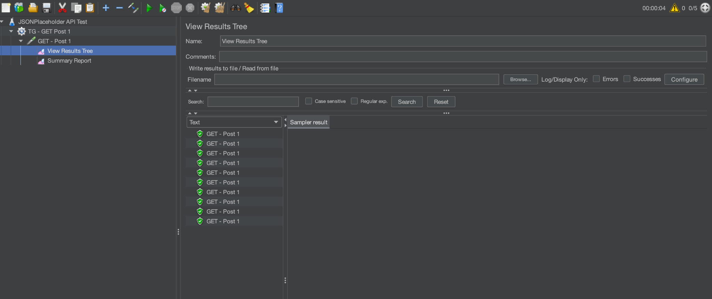
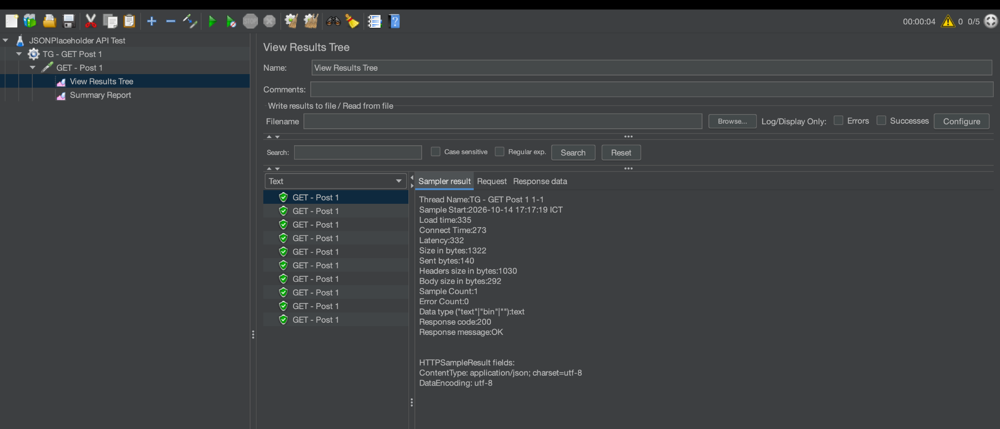
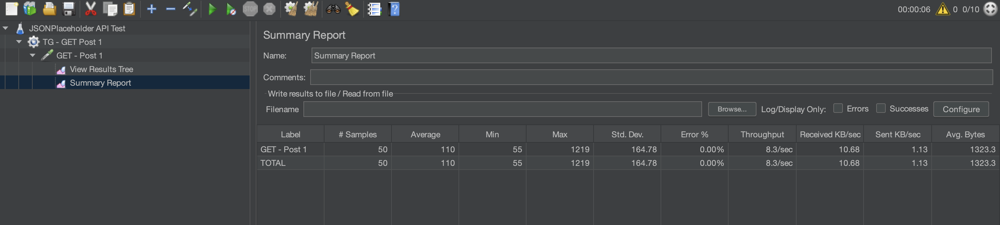
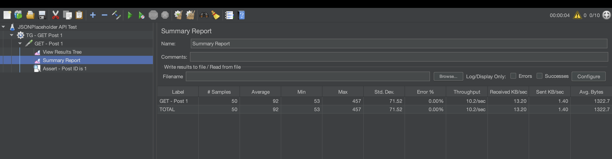

# Apache JMeter - API Testing with JSONPlaceholder

## 1. Giới thiệu

### 1.1. Tổng quan

Bài thực hành được thực hiện nhằm tìm hiểu và áp dụng **Apache JMeter** trong kiểm thử API. Thông qua bài thực hành, người thực hiện xây dựng các kịch bản kiểm thử HTTP, gửi yêu cầu đến API, theo dõi phản hồi từ máy chủ và đánh giá các chỉ số cơ bản về hiệu năng.

API được sử dụng là **JSONPlaceholder**, một REST API công khai phục vụ mục đích thực hành và thử nghiệm. Endpoint được lựa chọn trả về thông tin của một bài viết cụ thể.

### 1.2. Mục tiêu

Bài thực hành hướng đến các mục tiêu sau:

- Làm quen với giao diện và cách sử dụng Apache JMeter.
- Xây dựng Test Plan để kiểm thử API bằng giao thức HTTP.
- Cấu hình Thread Group, HTTP Request và các thành phần theo dõi kết quả.
- Thực hiện kiểm thử với các mức tải khác nhau.
- Đọc và phân tích các chỉ số như số lượng mẫu, thời gian phản hồi trung bình, thời gian phản hồi nhỏ nhất, lớn nhất, độ lệch chuẩn, tỷ lệ lỗi và thông lượng.
- Kiểm tra tính chính xác của dữ liệu JSON trả về bằng JSON Assertion.
- Lưu các kịch bản kiểm thử, ảnh minh chứng và báo cáo trên GitHub để thuận tiện cho việc quản lý và tái thực hiện.

## 2. Công cụ và môi trường thực hiện

| Thành phần | Thông tin |
|---|---|
| Công cụ kiểm thử | Apache JMeter 5.6.3 |
| Môi trường chạy | macOS |
| Ngôn ngữ thực thi | Java |
| Phiên bản Java | OpenJDK 21.0.12.1 |
| Đối tượng kiểm thử | JSONPlaceholder REST API |
| Phương thức HTTP | GET |
| Định dạng dữ liệu phản hồi | JSON |
| Công cụ quản lý mã nguồn | Git |
| Nền tảng lưu trữ | GitHub |

## 3. Đối tượng kiểm thử

### 3.1. Thông tin API

API được sử dụng trong bài thực hành:

- **Base URL:** `https://jsonplaceholder.typicode.com`
- **Endpoint:** `/posts/1`
- **HTTP Method:** `GET`
- **URL đầy đủ:** `https://jsonplaceholder.typicode.com/posts/1`

Yêu cầu GET được sử dụng để lấy thông tin bài viết có mã định danh là `1`.

### 3.2. Cấu trúc phản hồi

Khi yêu cầu hợp lệ được xử lý thành công, API trả về dữ liệu ở định dạng JSON với các trường cơ bản:

| Trường | Ý nghĩa |
|---|---|
| `userId` | Mã định danh người dùng sở hữu bài viết |
| `id` | Mã định danh bài viết |
| `title` | Tiêu đề bài viết |
| `body` | Nội dung bài viết |

Ví dụ minh họa cấu trúc dữ liệu phản hồi:

```json
{
  "userId": 1,
  "id": 1,
  "title": "sunt aut facere repellat provident occaecati",
  "body": "quia et suscipit..."
}
```

Đây là ví dụ rút gọn để minh họa cấu trúc JSON, không phải toàn bộ nội dung phản hồi.

### 3.3. Tiêu chí kiểm thử

Bài thực hành sử dụng các tiêu chí sau:

- API trả về mã trạng thái HTTP `200 OK` đối với yêu cầu GET thành công.
- Nội dung phản hồi có định dạng JSON.
- Trường `id` trong phản hồi có giá trị bằng `1`.
- Các mẫu được gửi đi và ghi nhận trong kết quả kiểm thử.
- Theo dõi tỷ lệ lỗi và các chỉ số thời gian phản hồi để đánh giá kết quả của từng kịch bản.

## 4. Cấu trúc repository

Repository được tổ chức như sau:

```text
jmeter-api-testing/
├── README.md
├── test-plans/
│   ├── jsonplaceholder-get.jmx
│   ├── jsonplaceholder-get-tc02.jmx
│   └── jsonplaceholder-json-assertion.jmx
├── screenshots/
│   ├── tc01-summary-report.png
│   ├── tc01-response-json.png
│   ├── tc02-summary-report.png
│   └── json-assertion-result.png
└── results/
```

Ý nghĩa các thành phần:

- `README.md`: tài liệu giới thiệu, mô tả kịch bản và tổng hợp kết quả kiểm thử.
- `test-plans/`: chứa các file `.jmx` dùng để lưu cấu hình Test Plan của JMeter.
- `screenshots/`: chứa ảnh chụp màn hình minh chứng cho kết quả kiểm thử.
- `results/`: thư mục dành cho các tệp kết quả được xuất ra trong quá trình kiểm thử, nếu có.

## 5. Thiết kế kịch bản kiểm thử

Bài thực hành gồm ba Test Plan tương ứng với ba mục tiêu: kiểm thử GET cơ bản, kiểm thử với mức tải lớn hơn và kiểm tra nội dung JSON.

### 5.1. TC01 - Kiểm thử GET API cơ bản

**File:** [`test-plans/jsonplaceholder-get.jmx`](test-plans/jsonplaceholder-get.jmx)

#### Mục tiêu

Kiểm tra khả năng gửi yêu cầu GET đến endpoint `/posts/1`, đồng thời quan sát phản hồi của API và thu thập các chỉ số hiệu năng cơ bản.

#### Cấu hình

| Tham số | Giá trị |
|---|---|
| Number of Threads (Users) | 5 |
| Ramp-Up Period | 5 giây |
| Loop Count | 2 |
| Tổng số mẫu dự kiến | 10 |
| HTTP Method | GET |
| Path | `/posts/1` |

Với 5 người dùng ảo, mỗi người thực hiện 2 lần lặp, tổng số yêu cầu dự kiến là:

`5 × 2 = 10 requests`

#### Các thành phần JMeter

- **Test Plan:** chứa toàn bộ cấu hình kiểm thử.
- **Thread Group:** xác định số người dùng ảo, thời gian khởi chạy và số lần lặp.
- **HTTP Request:** gửi yêu cầu GET đến API.
- **View Results Tree:** xem chi tiết từng mẫu, mã trạng thái và nội dung phản hồi.
- **Summary Report:** tổng hợp các chỉ số hiệu năng.
  
#### Kết quả

| Chỉ số | Kết quả |
|---|---:|
| Samples | 10 |
| Average | 140 ms |
| Min | 59 ms |
| Max | 335 ms |
| Std. Dev. | 86.49 ms |
| Error % | 0.00% |
| Throughput | 2.4 requests/second |
| Received KB/sec | 3.07 |
| Sent KB/sec | 0.32 |
| Avg. Bytes | 1323.2 |

#### Nhận xét

- JMeter ghi nhận đủ 10 mẫu theo cấu hình đã thiết lập.
- Tỷ lệ lỗi được ghi nhận là `0.00%`, nghĩa là không có mẫu nào được đánh dấu lỗi trong lần chạy này.
- Thời gian phản hồi trung bình là `140 ms`; thời gian nhỏ nhất là `59 ms` và lớn nhất là `335 ms`.
- Độ lệch chuẩn `86.49 ms` cho thấy thời gian phản hồi giữa các mẫu có sự dao động.
- Thông lượng ghi nhận là `2.4 requests/second` trong điều kiện chạy thử này.

Các kết quả trên phản ánh lần chạy cụ thể, không đại diện cho hiệu năng cố định của API trong mọi điều kiện mạng hoặc tải hệ thống.

#### Ảnh minh chứng

**Summary Report - TC01**



**Response JSON - TC01**



### 5.2. TC02 - Kiểm thử với số lượng yêu cầu lớn hơn

**File:** [`test-plans/jsonplaceholder-get-tc02.jmx`](test-plans/jsonplaceholder-get-tc02.jmx)

#### Mục tiêu

Thay đổi cấu hình người dùng ảo và số lần lặp nhằm quan sát các chỉ số của API khi số lượng yêu cầu tăng lên so với TC01.

#### Cấu hình

| Tham số | Giá trị |
|---|---|
| Number of Threads (Users) | 10 |
| Ramp-Up Period | 5 giây |
| Loop Count | 5 |
| Tổng số mẫu dự kiến | 50 |
| HTTP Method | GET |
| Path | `/posts/1` |

Tổng số yêu cầu dự kiến:

`10 × 5 = 50 requests`

So với TC01, TC02 tăng số người dùng ảo từ 5 lên 10 và tăng số lần lặp từ 2 lên 5. Vì vậy, tổng số mẫu dự kiến tăng từ 10 lên 50.

#### Kết quả

| Chỉ số | Kết quả |
|---|---:|
| Samples | 50 |
| Average | 89 ms |
| Min | 56 ms |
| Max | 197 ms |
| Std. Dev. | 47.83 ms |
| Error % | 0.00% |
| Throughput | 10.0 requests/second |
| Received KB/sec | 12.97 |
| Sent KB/sec | 1.37 |
| Avg. Bytes | 1322.1 |

#### Nhận xét

- JMeter ghi nhận 50 mẫu, phù hợp với số lượng yêu cầu dự kiến theo cấu hình.
- Tỷ lệ lỗi ghi nhận là `0.00%` trong lần chạy này.
- Thời gian phản hồi trung bình là `89 ms`, thời gian nhỏ nhất là `56 ms` và lớn nhất là `197 ms`.
- Thông lượng ghi nhận là `10.0 requests/second`.
- Độ lệch chuẩn là `47.83 ms`, thể hiện mức dao động thời gian phản hồi giữa các mẫu trong lần chạy này.

So sánh số liệu của TC01 và TC02 cho thấy lần chạy TC02 ghi nhận thời gian phản hồi trung bình thấp hơn và thông lượng cao hơn. Tuy nhiên, không thể kết luận rằng tăng tải làm API phản hồi nhanh hơn chỉ từ hai lần chạy này. Kết quả còn chịu ảnh hưởng của thời điểm thực hiện, độ trễ mạng, trạng thái máy chủ và các yếu tố môi trường khác.

Để đánh giá khả năng chịu tải một cách đáng tin cậy hơn, cần thực hiện nhiều lần chạy, kiểm soát điều kiện thử nghiệm và tăng tải theo các mức được xác định trước.

#### Ảnh minh chứng

**Summary Report - TC02**



### 5.3. TC03 - Kiểm tra nội dung JSON bằng JSON Assertion

**File:** [`test-plans/jsonplaceholder-json-assertion.jmx`](test-plans/jsonplaceholder-json-assertion.jmx)

#### Mục tiêu

Kiểm tra không chỉ việc API phản hồi thành công mà còn xác nhận dữ liệu trả về có giá trị đúng theo yêu cầu.

Trong kịch bản này, JSON Assertion được sử dụng để kiểm tra trường `id` của phản hồi JSON.

#### Cấu hình JSON Assertion

| Tham số | Giá trị |
|---|---|
| Đối tượng kiểm thử | Phản hồi của yêu cầu GET `/posts/1` |
| Loại kiểm tra | JSON Assertion |
| JSON Path | `$.id` |
| Giá trị mong đợi | `1` |
| Mục tiêu | Xác nhận mã bài viết trả về đúng |

JSON Path `$.id` có nghĩa là truy cập trường `id` ở cấp cao nhất của đối tượng JSON.

Ví dụ, với dữ liệu:

```json
{
  "userId": 1,
  "id": 1,
  "title": "Example title",
  "body": "Example body"
}
```

Giá trị tại `$.id` là `1`, nên assertion được kỳ vọng sẽ thành công khi cấu hình so sánh giá trị chính xác.

#### Kết quả

Trong lần kiểm thử được ghi nhận, người thực hiện đã xác nhận tỷ lệ lỗi trở về `0%`.

Kết quả này phù hợp với mục tiêu của kịch bản nếu JSON Assertion đã được cấu hình để so sánh `$.id` với giá trị mong đợi `1` và các mẫu kiểm thử đều thành công.

#### Ý nghĩa

JSON Assertion giúp phát hiện trường hợp API có thể trả về phản hồi HTTP thành công nhưng nội dung dữ liệu không đáp ứng yêu cầu. Vì vậy, kiểm thử kết hợp mã trạng thái HTTP với assertion trên nội dung JSON cung cấp mức xác minh tốt hơn so với chỉ kiểm tra mã trạng thái.

#### Ảnh minh chứng



## 6. Tổng hợp kết quả kiểm thử

### 6.1. Bảng so sánh TC01 và TC02

| Chỉ số | TC01 | TC02 |
|---|---:|---:|
| Number of Threads | 5 | 10 |
| Ramp-Up Period | 5 giây | 5 giây |
| Loop Count | 2 | 5 |
| Samples | 10 | 50 |
| Average | 140 ms | 89 ms |
| Min | 59 ms | 56 ms |
| Max | 335 ms | 197 ms |
| Std. Dev. | 86.49 ms | 47.83 ms |
| Error % | 0.00% | 0.00% |
| Throughput | 2.4 requests/sec | 10.0 requests/sec |

### 6.2. Đánh giá chung

Dựa trên các kết quả đã ghi nhận:

- **Về số lượng mẫu:** cả TC01 và TC02 đều ghi nhận đủ số mẫu dự kiến theo cấu hình.
- **Về tỷ lệ lỗi:** cả hai lần chạy đều ghi nhận `0.00%`.
- **Về thời gian phản hồi:** TC01 có thời gian trung bình `140 ms`; TC02 có thời gian trung bình `89 ms`.
- **Về thông lượng:** TC01 ghi nhận `2.4 requests/second`, trong khi TC02 ghi nhận `10.0 requests/second`.
- **Về độ chính xác dữ liệu:** JSON Assertion được sử dụng để kiểm tra trường `id` có giá trị mong đợi.

Các kết quả này cho thấy những kịch bản đã thực hiện hoạt động đúng theo các chỉ số ghi nhận trong những lần chạy tương ứng. Tuy nhiên, dữ liệu hiện tại chỉ phản ánh một số lần chạy thử nghiệm với một endpoint và chưa đủ để đưa ra kết luận tổng quát về giới hạn chịu tải hoặc hiệu năng tối đa của hệ thống.

### 6.3. Phân biệt kiểm thử chức năng và kiểm thử hiệu năng

Bài thực hành kết hợp hai mục tiêu khác nhau:

- **Kiểm thử chức năng:** xác minh API trả về phản hồi phù hợp và trường JSON `id` có giá trị bằng `1`.
- **Kiểm thử hiệu năng cơ bản:** ghi nhận thời gian phản hồi, thông lượng, số lượng mẫu và tỷ lệ lỗi trong các cấu hình thử nghiệm khác nhau.

Việc kết hợp hai mục tiêu này giúp kiểm tra cả tính đúng đắn của phản hồi lẫn cách API được ghi nhận dưới các mức tải thử nghiệm.

## 7. Hướng dẫn chạy lại các kịch bản

### 7.1. Mở Test Plan

1. Khởi động Apache JMeter.
2. Chọn **File → Open**.
3. Chọn một file `.jmx` trong thư mục `test-plans/`.
4. Kiểm tra lại cấu hình Thread Group, HTTP Request và các listener.

### 7.2. Thực hiện kiểm thử

1. Chọn listener **Summary Report** hoặc **View Results Tree**.
2. Xóa kết quả cũ bằng nút Clear nếu cần.
3. Nhấn nút Start để chạy Test Plan.
4. Chờ đến khi các mẫu được xử lý xong.
5. Quan sát kết quả trong Summary Report.
6. Mở View Results Tree để xem chi tiết phản hồi và kiểm tra assertion.

### 7.3. Lưu ý khi chạy lại

- Kết quả mới có thể khác kết quả trong báo cáo do điều kiện mạng, thời điểm chạy và trạng thái máy chủ.
- Nên xóa kết quả cũ trước mỗi lần chạy để tránh nhầm lẫn giữa các lần thử nghiệm.
- JSONPlaceholder là API phục vụ mục đích thực hành. Bài thực hành này chỉ sử dụng GET để truy xuất dữ liệu, không nhằm đánh giá một hệ thống nghiệp vụ thực tế.
- Không nên gửi lượng yêu cầu quá lớn đến API công khai hoặc thực hiện kiểm thử tải vượt quá mục đích học tập.

## 8. Hạn chế và hướng phát triển

### 8.1. Hạn chế

- Bài thực hành mới kiểm thử một endpoint GET.
- Số lượng người dùng ảo và số lần lặp còn giới hạn.
- Kết quả chưa được thu thập qua nhiều lần chạy có kiểm soát.
- Chưa có kiểm thử POST, PUT hoặc DELETE.
- Chưa thực hiện kiểm thử tải kéo dài, kiểm thử tăng tải theo từng giai đoạn hoặc kiểm thử sức chịu tải tối đa.
- Các chỉ số hiện có chưa đủ để xác định giới hạn hiệu năng của API.

### 8.2. Hướng phát triển

Trong các lần thực hành tiếp theo, có thể mở rộng bài kiểm thử theo các hướng:

- Bổ sung nhiều endpoint khác nhau.
- Tạo các kịch bản POST, PUT và DELETE nếu phù hợp với API được sử dụng.
- Thử nghiệm nhiều mức tải và thực hiện mỗi kịch bản nhiều lần.
- Phân tích thêm các phân vị thời gian phản hồi như P90, P95 và P99.
- Thiết lập ngưỡng chấp nhận cho thời gian phản hồi và tỷ lệ lỗi.
- Xuất kết quả kiểm thử thành tệp CSV hoặc báo cáo HTML để thuận tiện cho việc phân tích.
- So sánh kết quả giữa các lần chạy trong cùng điều kiện thử nghiệm.

## 9. Kết luận

Thông qua bài thực hành, người thực hiện đã làm quen với Apache JMeter và xây dựng được các kịch bản kiểm thử API bằng HTTP Request. Bài thực hành đã sử dụng Thread Group để điều chỉnh số lượng người dùng ảo, Summary Report để theo dõi các chỉ số hiệu năng và View Results Tree để kiểm tra phản hồi của API.

Bên cạnh đó, JSON Assertion được áp dụng nhằm xác minh giá trị trường `id` trong dữ liệu JSON trả về. Ba file Test Plan được lưu trong repository, cùng với bốn ảnh minh chứng cho kết quả kiểm thử.

Bài thực hành giúp củng cố kiến thức cơ bản về kiểm thử API, phân tích số liệu hiệu năng và quản lý các tài liệu kiểm thử bằng GitHub. Đây là cơ sở để tiếp tục tìm hiểu các kỹ thuật kiểm thử chức năng và hiệu năng phần mềm ở mức nâng cao hơn.

## 10. Repository và tài liệu tham khảo

- **GitHub repository:** [Hoangthingoc216/jmeter-api-testing](https://github.com/Hoangthingoc216/jmeter-api-testing)
- **Apache JMeter:** https://jmeter.apache.org/
- **JSONPlaceholder:** https://jsonplaceholder.typicode.com/
- **Endpoint được kiểm thử:** https://jsonplaceholder.typicode.com/posts/1

---

*Báo cáo được xây dựng dựa trên các kịch bản JMeter và số liệu đã ghi nhận trong quá trình thực hành. Kết quả có thể thay đổi khi chạy lại trong điều kiện khác.*